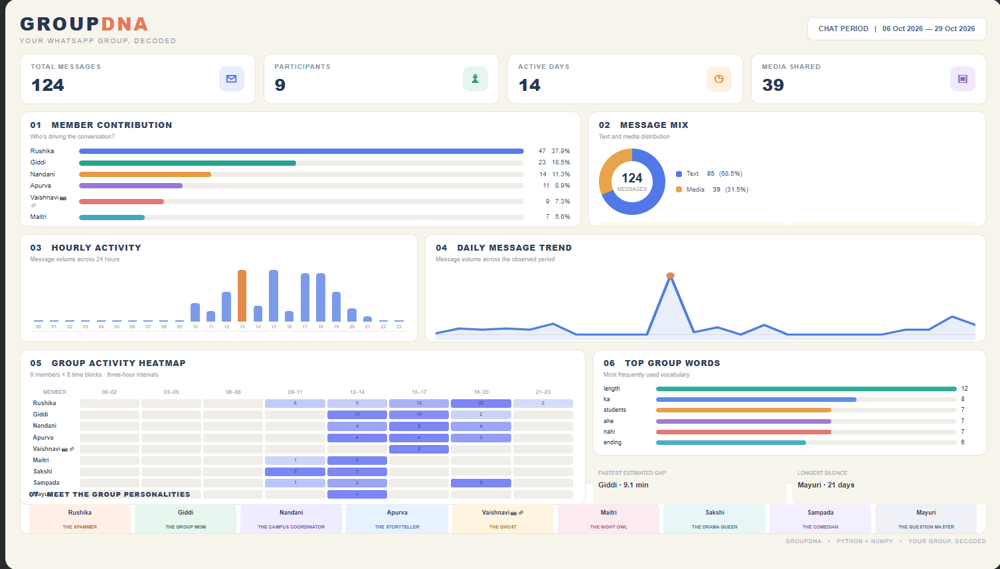

# GroupDNA – WhatsApp Group Chat Analyzer

**A Python and NumPy-based project that analyzes WhatsApp group conversations to discover participant activity, communication patterns, and meaningful group insights.**

## 📸 Project Outputs

### 1. Official Project Dataset Dashboard

Dashboard generated using the official `hostel_bois.txt` dataset provided for the Unlox Academy Industry-Graded Minor Project.

### 2. Personal Group Data Dashboard

An additional demonstration using a personal WhatsApp group dataset to explore how GroupDNA can be applied to real-world group conversations.

## 🎯 Project Objectives

- Analyze individual participant contributions.
- Identify the busiest day and hour.
- Find the most frequently used words.
- Generate a 6 × 24 participant activity heatmap using NumPy.
- Calculate response times and longest silent streaks.
- Assign unique personality-based archetypes to group members.
- Present insights through a visual dashboard.

## 🛠️ Technologies Used

- Python
- NumPy
- Google Colab
- HTML and CSS for dashboard presentation

## ✨ Key Features

1. WhatsApp chat parsing and preprocessing.
2. Participant-wise message statistics.
3. Most frequently used words analysis.
4. Hourly activity heatmap.
5. Response time analysis.
6. Longest silent streak detection.
7. Eight unique participant archetypes.
8. Final analytical report.
9. Compact visual dashboard.

## 📋 Project Constraints

### Allowed

- Python fundamentals and control statements.
- Lists, tuples, sets, and dictionaries.
- NumPy for numerical calculations.
- File handling and basic string operations.
- `datetime.strptime()` and `timedelta`.
- `sorted()` with key and reverse arguments.
- Lambda functions.

### Not Allowed

- Pandas.
- Matplotlib, Seaborn, and Plotly.
- Regular expressions.
- `collections.Counter` and `defaultdict`.
- WhatsApp analyzer libraries.
- AI/ML libraries.
- External datasets.
- List and dictionary comprehensions.

The core analysis was implemented using the permitted Python features and NumPy.

## 📂 Project Files

- `GroupDNA_Mayuri_Nilange.ipynb` – Complete project implementation and analysis.
- `hostel_bois.txt` – Official synthetic WhatsApp chat dataset.
- `dashboard.png` – Dashboard generated using the official dataset.
- `personal_dashboard.png` – Additional personal group data dashboard.

## 🚀 How to Run the Project

1. Open the notebook using Google Colab.
2. Upload `hostel_bois.txt` to the Colab session.
3. Open `GroupDNA_Mayuri_Nilange.ipynb`.
4. Run all notebook cells in the correct order.
5. Explore the generated statistics, insights, and dashboard.

## 👩‍💻 Project Information

**Project Name:** GroupDNA – WhatsApp Group Chat Analyzer

**Organization:** Unlox Academy

**Project Type:** Industry-Graded Minor Project

**Author:** Mayuri Nilange

---

*Developed as part of the Unlox Academy Industry-Graded Minor Project.*

---

*Developed as part of the Unlox Academy Industry-Graded Minor Project.*
